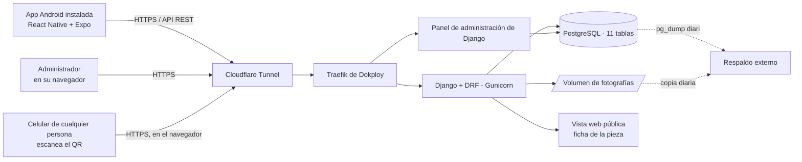
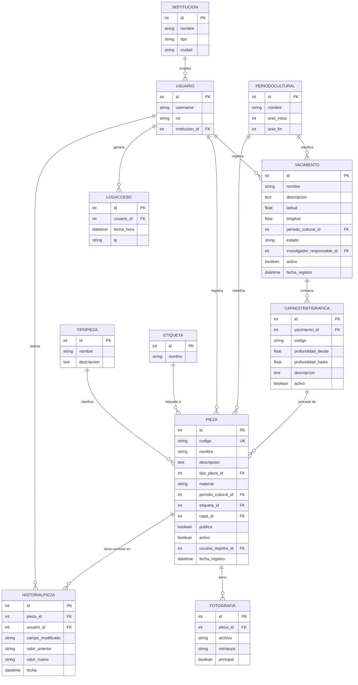
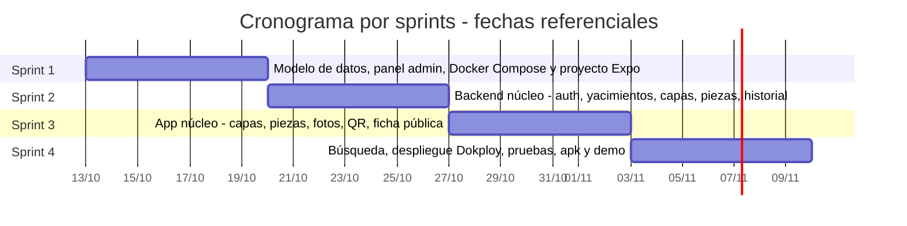

# Sistema de Información Web-Móvil para la Catalogación, Trazabilidad y Gestión de Hallazgos Arqueológicos
## Nombre de proyecto: ArqueoCatalog

| Campo | Detalle |
|---|---|
| **Tipo de trabajo** | Proyecto individual de 4 semanas |
| **Universidad / carrera** | Universidad Mayor de San Andrés (UMSA) · Ingeniería de Sistemas |
| **Contexto aplicado** | Patrimonio y Humanidades (arqueología) |
| **Tipo de sistema** | Sistema de información centralizado: API REST + base de datos, panel de administración web, ficha pública web y app móvil Android (React Native + Expo) |
| **Metodología de desarrollo** | Desarrollo iterativo e incremental basado en sprints semanales, con gestión visual mediante Kanban |
| **Estudiante** | *(nombre completo)* |
| **Docente / mentor** | *(nombre)* |
| **Entorno de ejecución** | Docker Compose (entorno base garantizado); despliegue en homelab con Dokploy y Cloudflare Tunnel como objetivo de cierre |

---

## 1. Resumen ejecutivo

ArqueoCatalog es un sistema de información centralizado para **registrar, catalogar, clasificar y dar trazabilidad** a hallazgos arqueológicos. Se compone de cuatro partes que comparten un único backend y una única base de datos:

1. **Backend centralizado:** API REST en Django + Django REST Framework sobre PostgreSQL (11 tablas), empaquetado con Docker Compose y desplegable con Dokploy en un homelab propio.
2. **Aplicación móvil Android instalable** (`.apk`, React Native + Expo), usada por investigadores en trabajo de campo: registrar yacimientos, capas estratigráficas y piezas, fotografiar las piezas, clasificarlas, consultar su historial de cambios y generar su código QR.
3. **Panel de administración web** (admin de Django), usado por el administrador para gestionar usuarios, instituciones, catálogos (periodo cultural, tipo de pieza, etiqueta) y consultar el registro de accesos.
4. **Ficha pública web** muy simple, a la que cualquier persona llega al escanear el QR de una pieza, sin instalar nada.

Al cabo de 4 semanas, el resultado esperado es un sistema **funcional y defendible**: backend en contenedores, panel de administración, app instalada en un celular Android real, datos de ejemplo cargados y demo en vivo.

---

## 2. Planteamiento del problema

Actualmente, el registro y catalogación de hallazgos arqueológicos puede realizarse mediante documentos físicos y archivos digitales dispersos (hojas de cálculo, carpetas de fotos, cuadernos de campo), lo que dificulta la organización, consulta y trazabilidad de la información asociada a cada hallazgo. La ausencia de un sistema centralizado limita el acceso estructurado a datos como ubicación, procedencia estratigráfica, fotografías, clasificación e historial de modificaciones, y puede generar duplicidad de información, pérdida de registros y dificultad para que varios investigadores e instituciones trabajen sobre los mismos hallazgos.

**Pregunta de investigación / problema:** ¿Cómo mejorar el registro, clasificación, trazabilidad y consulta de información de hallazgos arqueológicos mediante un sistema de información centralizado, con una aplicación móvil para trabajo de campo y un panel web de administración?

## 3. Justificación

- **Académica:** integra análisis de requisitos, modelado de un dominio de datos de tamaño medio (11 tablas, con catálogos y jerarquías), diseño de API REST, control de acceso por roles, trazabilidad automática de cambios, contenedorización, despliegue en infraestructura propia y desarrollo de una app móvil.
- **Social y cultural:** permite que investigadores de distintas instituciones (museos, universidades) documenten hallazgos de forma centralizada y con trazabilidad, y que el público consulte fichas de piezas habilitadas.
- **Técnica:** da experiencia real diseñando un modelo de datos normalizado, construyendo una API consumida por un cliente móvil y operando infraestructura de backend en contenedores con prácticas básicas de seguridad.

---

## 4. Objetivos

### 4.1 Objetivo general
Diseñar e implementar un sistema de información web-móvil, respaldado por un backend centralizado y contenedorizado, para la catalogación, trazabilidad y gestión de hallazgos arqueológicos.

### 4.2 Objetivos específicos
Se ordenan siguiendo el ciclo de vida del desarrollo de software:

- **OE1. Análisis.** Analizar los procesos y requerimientos de registro, clasificación y trazabilidad de hallazgos arqueológicos para definir las funcionalidades del sistema.
- **OE2. Diseño.** Diseñar la arquitectura del sistema y el modelo de datos relacional que gestione yacimientos, capas estratigráficas, piezas, catálogos, usuarios e instituciones.
- **OE3. Backend.** Desarrollar el backend: una API REST en Django con autenticación JWT, control de acceso por roles, trazabilidad automática de cambios en las piezas, registro de accesos y panel de administración.
- **OE4. Aplicaciones cliente.** Desarrollar la aplicación móvil instalable (Android) para registrar, modificar y consultar capas, piezas y yacimientos, con fotografías de piezas, búsqueda, filtrado y ubicación geográfica, y la ficha pública web accesible mediante código QR.
- **OE5. Infraestructura y seguridad.** Configurar el despliegue del backend en contenedores (Docker Compose y, como cierre, Dokploy con HTTPS), con gestión segura de secretos, respaldos y acceso externo controlado.
- **OE6. Pruebas y validación.** Verificar el sistema mediante pruebas automatizadas del backend, pruebas manuales en un dispositivo Android real y una demostración del flujo completo.

---

## 5. Delimitación

**Delimitación temática.** El proyecto se limita a la gestión y catalogación digital de hallazgos arqueológicos: yacimientos, capas estratigráficas, piezas, su clasificación y trazabilidad.

**Alcance de la trazabilidad.** La trazabilidad detallada de cambios (historial automático con campo, valor anterior, valor nuevo, usuario y fecha) se aplica **exclusivamente al ciclo de vida de la pieza arqueológica** (`PIEZA`). Los yacimientos y las capas conservan su autoría y fecha de registro, pero sus modificaciones no generan historial. La procedencia de cada pieza (capa y yacimiento) es siempre trazable por la estructura del modelo. Además, el sistema registra los inicios de sesión exitosos como auditoría de acceso.

**Delimitación funcional.** El sistema permitirá: autenticación y auditoría de accesos; gestión de usuarios con dos roles e institución de pertenencia; registro de yacimientos y sus capas estratigráficas; registro de piezas clasificadas por catálogos (periodo cultural, tipo, etiqueta); fotografías de piezas; historial automático de cambios de una pieza; búsqueda, filtros y ubicación geográfica; y generación de código QR con ficha pública. Los catálogos y las instituciones se administran desde el panel de administración web, no desde la app móvil, porque cambian con poca frecuencia y no requieren una interfaz de campo. En la app, el formulario de yacimiento se limita a datos mínimos; el desarrollo de interfaz móvil se concentra en capas y piezas, que son el núcleo del trabajo de campo.

**Origen de los datos de ubicación.** Las coordenadas de un yacimiento (`latitud`, `longitud`) se ingresan como datos numéricos explícitos. No se leen del EXIF de las fotografías, porque este se elimina por privacidad al subir una imagen.

**Delimitación de eliminación.** Los registros arqueológicos no se eliminan físicamente: la eliminación es lógica (campo `activo`) y solo la ejecuta el Administrador, para no romper el historial ni la procedencia de las piezas.

**Delimitación tecnológica.** El cliente de campo es una **aplicación móvil Android instalable (`.apk`)** con React Native y Expo. El backend usa Django y PostgreSQL, con coordenadas como campos numéricos simples (sin extensión geoespacial). La app se distribuye como archivo instalable fuera de una tienda de aplicaciones (sideloading).

**Delimitación metodológica.** El desarrollo sigue una metodología iterativa e incremental basada en sprints semanales, con gestión visual mediante Kanban (ver secciones 10 y 18).

**Delimitación temporal.** El prototipo funcional se desarrolla en **4 semanas** (4 sprints).

---

## 6. Alcance

### 6.1 Módulos incluidos

| # | Módulo | Qué incluye | Dónde se gestiona | Prioridad |
|---|---|---|---|:---:|
| M1 | Autenticación, usuarios, instituciones y auditoría de accesos | Login JWT, roles (Administrador, Investigador), institución de pertenencia; registro automático de inicios de sesión (señal de Django), visible solo en el panel admin | App (login) · Panel admin (gestión y log de accesos) | Núcleo |
| M2 | Gestión de yacimientos | Alta y edición con datos mínimos en la app (nombre, ubicación, periodo cultural, estado); gestión completa en el panel admin | App (formulario mínimo) · Panel admin | Alta |
| M3 | Estratigrafía (capas) | CRUD de capas estratigráficas dentro de un yacimiento | App | **Núcleo** |
| M4 | Gestión de piezas/hallazgos | CRUD de piezas, código autogenerado, clasificadas por tipo, material, periodo cultural y etiqueta, vinculadas a una capa | App | **Núcleo** |
| M5 | Fotografías de piezas, QR y ficha pública | Fotos de piezas; QR por pieza; ficha pública web | App (fotos, QR) · Web (ficha pública) | Alta |
| M6 | Catálogos del sistema | Periodo cultural, tipo de pieza, etiqueta | Panel admin | Alta |
| M7 | Historial de cambios | Registro automático de modificaciones de una pieza (quién, cuándo, qué cambió) | App (consulta, solo lectura) | Alta |
| M8 | Búsqueda, filtros y ubicación | Búsqueda por texto y filtros de yacimientos/piezas; abrir ubicación en el mapa del celular | App | Media |

### 6.2 Fuera de alcance

- **Fotografías de yacimientos:** el manejo de imágenes se concentra en las piezas.
- **Exposiciones temporales** (creación de exposiciones y asignación de piezas): es una función administrativa de museo, no de registro de campo.
- **Etiquetado múltiple (muchos a muchos):** cada pieza tiene una sola etiqueta principal.
- **Historial de cambios de yacimientos y capas.**
- **Registro de intentos de inicio de sesión fallidos.**
- Unidad de excavación como nivel intermedio entre yacimiento y capa.
- Préstamo formal de piezas entre instituciones.
- Publicación en Google Play Store y versión para iOS.
- Modo sin conexión con sincronización posterior, y notificaciones push.
- Modelado 3D, fotogrametría, inteligencia artificial o reconocimiento automático de piezas.
- Integración con sistemas externos de otras instituciones o museos.
- API pública documentada para terceros.
- Línea de tiempo cronológica interactiva.
- Exportación a PDF/CSV.
- Rol "asistente" o cuentas públicas registradas.
- Extensión geoespacial (PostGIS), geocercas y mapa embebido dentro de la app.
- Almacenamiento de objetos distribuido (S3/SeaweedFS); se usa almacenamiento en disco.

Estos puntos se retoman como trabajo futuro en la sección 15.

---

## 7. Usuarios y roles

| Rol | Descripción |
|---|---|
| **Administrador** | Gestiona usuarios, instituciones, catálogos y el log de accesos (panel admin); tiene acceso total desde la app, incluida la eliminación lógica de registros. |
| **Investigador** | Pertenece a una institución; crea, edita y consulta yacimientos, capas y piezas desde la app; sube fotos de piezas, clasifica piezas, consulta su historial y genera QR. No elimina registros. |
| **Público (sin cuenta, sin app)** | Accede únicamente a la ficha pública de una pieza marcada como pública, abriendo en su navegador el enlace del QR. |

### Matriz de permisos

| Acción | Administrador | Investigador | Público |
|---|:---:|:---:|:---:|
| Gestionar usuarios e instituciones (panel admin) | ✔ | ✘ | ✘ |
| Gestionar catálogos: periodo, tipo, etiqueta (panel admin) | ✔ | ✘ | ✘ |
| Crear, ver y editar yacimientos, capas y piezas (app) | ✔ | ✔ | ✘ |
| Eliminar yacimientos, capas y piezas (eliminación lógica) | ✔ | ✘ | ✘ |
| Subir fotos de piezas (app) | ✔ | ✔ | ✘ |
| Ver historial de cambios de una pieza (app, solo lectura) | ✔ | ✔ | ✘ |
| Ver log de accesos (panel admin) | ✔ | ✘ | ✘ |
| Ver ficha pública de una pieza | ✔ | ✔ | ✔ (solo si es pública; si no, recibe HTTP 403 "Ficha restringida por la institución") |
| Buscar, filtrar y ver ubicación (app) | ✔ | ✔ | ✘ |

---

## 8. Requisitos funcionales

| ID | Requisito | Módulo |
|---|---|:---:|
| RF-01 | Inicio de sesión desde la app, con JWT | M1 |
| RF-02 | El administrador gestiona usuarios, su rol y su institución, desde el panel admin | M1 |
| RF-03 | El administrador registra instituciones desde el panel admin | M1 |
| RF-04 | El sistema registra automáticamente cada inicio de sesión **exitoso** (usuario, fecha y hora, IP) mediante la señal nativa `user_logged_in` de Django, visible por el administrador en el panel admin. Los intentos fallidos no se registran | M1 |
| RF-05 | Alta y edición de yacimientos desde la app con datos mínimos (nombre, latitud, longitud ingresadas como valores numéricos, periodo cultural, estado); gestión completa (incluida descripción) desde el panel admin | M2 |
| RF-06 | CRUD de capas estratigráficas dentro de un yacimiento (código, profundidad, descripción) | M3 |
| RF-07 | CRUD de piezas con código único autogenerado, tipo, material, periodo cultural, etiqueta y capa de procedencia. La eliminación es lógica y solo la ejecuta el Administrador | M4 |
| RF-08 | Captura o selección de fotografías de una pieza, con eliminación de metadatos EXIF | M5 |
| RF-09 | Generación de un código QR único por pieza, visible dentro de la app | M5 |
| RF-10 | Ficha pública web de la pieza, accesible desde el QR sin iniciar sesión, si la pieza está marcada como pública (`publica = True`). Si la pieza **no** es pública, la vista responde con **HTTP 403** y una pantalla "Ficha restringida por la institución", sin revelar datos de la pieza. Si el código no existe, responde HTTP 404 | M5 |
| RF-11 | El administrador gestiona los catálogos de periodo cultural, tipo de pieza y etiqueta desde el panel admin | M6 |
| RF-12 | El sistema registra automáticamente cada modificación de una pieza (campo, valor anterior, valor nuevo, usuario, fecha) | M7 |
| RF-13 | El investigador consulta el historial de una pieza desde la app | M7 |
| RF-14 | Listado de piezas y yacimientos con búsqueda por texto y filtros (periodo, tipo, etiqueta, yacimiento) | M8 |
| RF-15 | Botón "ver en el mapa" que abre la ubicación de un yacimiento (a partir de sus coordenadas registradas) en la app de mapas del celular | M8 |

## 9. Requisitos no funcionales

| Categoría | Requisito |
|---|---|
| **Instalabilidad** | La app se distribuye como archivo `.apk` firmado, instalable en un celular Android sin pasar por Google Play. |
| **Seguridad** | Contraseñas con hash, JWT con expiración, token almacenado en el celular con `expo-secure-store`, HTTPS obligatorio en el despliegue externo, CORS restringido, secretos en variables de entorno. |
| **Integridad de los catálogos** | Los catálogos (periodo, tipo, etiqueta) y las instituciones solo se crean/editan desde el panel admin, para evitar duplicados creados desde el campo. |
| **Integridad de los registros** | Los registros arqueológicos no se eliminan físicamente; solo se desactivan (eliminación lógica) por el Administrador. |
| **Trazabilidad** | Ninguna modificación de una pieza debe perderse: el historial se genera automáticamente mediante señales de Django, no manualmente. Aplica exclusivamente a la pieza (no a yacimientos ni capas). |
| **Privacidad de imágenes** | Eliminación de metadata EXIF (incluida ubicación GPS) al subir una fotografía. La ubicación de un yacimiento se registra solo mediante sus campos numéricos de latitud y longitud. |
| **Rendimiento** | Listados paginados; índices en las llaves foráneas más consultadas (capa, periodo, tipo, etiqueta); imágenes redimensionadas antes de subirlas. |
| **Disponibilidad del backend** | Reinicio automático de contenedores y endpoint de salud. |
| **Respaldo** | Copia diaria de la base de datos y de la carpeta de fotografías. |
| **Mantenibilidad** | Código con linter y pruebas automatizadas en los módulos centrales del backend. |
| **Portabilidad del backend** | Todo el backend se levanta con Docker Compose, tanto en el entorno local como en el homelab. |

---

## 10. Metodología de desarrollo

Se adopta una **metodología de desarrollo iterativa e incremental basada en sprints, con gestión visual mediante Kanban**. Cada sprint dura una semana y produce un incremento funcional y demostrable, en lugar de dejar la integración para el final. Es un proceso propio de un proyecto individual: toma de Scrum y Kanban prácticas de planificación y seguimiento, pero **no pretende ser Scrum**, que es un marco para equipos colaborativos con roles diferenciados.

| Elemento | Aplicación en este proyecto |
|---|---|
| **Responsables** | El estudiante planifica, desarrolla y prioriza; el docente/mentor valida cada incremento y orienta el rumbo. |
| **Backlog priorizado** | Los requisitos funcionales (RF-01 a RF-15) se convierten en historias de usuario priorizadas según la columna "Prioridad" de los módulos (núcleo primero). |
| **Iteraciones (sprints)** | 4 sprints de 1 semana, cada uno con un objetivo y un incremento entregable (sección 18). |
| **Planificación de la iteración** | Al inicio de cada semana se seleccionan del backlog las historias del sprint y se estiman en horas. |
| **Seguimiento diario** | Registro breve diario (qué hice, qué haré, qué me bloquea) en el tablero del repositorio. |
| **Revisión de la iteración** | Al final de cada semana: demo del incremento al docente y recogida de observaciones. |
| **Retrospectiva** | Breve revisión de qué ajustar para el siguiente sprint; si hay atraso, se aplica el plan de recorte (sección 20). |
| **Gestión visual (Kanban)** | Tablero en GitHub Projects (Por hacer · En curso · En revisión · Hecho), con límite de trabajo en curso para evitar dispersión. |
| **Criterio de terminado** | Funcionalidad implementada, probada (automática en backend, manual en celular), ejecutándose en Docker Compose y sin errores de linter. |

**Por qué iterativo-incremental y no cascada:** el alcance es amplio para el tiempo disponible; entregar valor por semanas permite detectar desvíos pronto y recortar con criterio, conservando siempre un sistema funcional en cada cierre de sprint.

---

## 11. Diseño de la aplicación móvil (React Native + Expo)

Se usa **React Native con Expo** para la app instalable: reutiliza JavaScript/React y reduce la curva de aprendizaje de construir una app nativa en 4 semanas y en solitario. La app es **un cliente más del sistema**, no el sistema completo. El reparto de responsabilidades es:

- **En la app (trabajo de campo):** capas, piezas, fotos de piezas, QR, historial de una pieza (solo lectura), búsqueda y filtros; alta y edición de yacimientos con un formulario mínimo.
- **En el panel de administración de Django (trabajo de oficina, poco frecuente):** usuarios, instituciones, catálogos, gestión completa de yacimientos y log de accesos.

Esta división es una decisión de arquitectura: concentra el esfuerzo de interfaz móvil en el núcleo (capas y piezas) y usa una herramienta ya existente (el admin de Django) para lo administrativo.

**Decisiones de la app:**
- **Navegación:** React Navigation, con pestañas inferiores (Yacimientos, Piezas, Perfil).
- **Cámara y fotos:** `expo-image-picker` / `expo-camera`, solo para piezas.
- **Sesión:** JWT guardado con `expo-secure-store`.
- **Selectores de catálogo:** periodo cultural, tipo de pieza y etiqueta se muestran como listas desplegables, pobladas desde la API (`/catalogos/...`), de solo lectura desde la app.
- **Ubicación:** las coordenadas se ingresan como números; el botón "Ver en el mapa" abre la app de mapas del celular (`Linking`).
- **Código QR:** se genera en el backend y se muestra en la app.
- **Distribución para la demo:** `.apk` generado con **EAS Build** (plan gratuito, hasta 15 compilaciones de Android al mes — [expo.dev/pricing](https://expo.dev/pricing.md)). Como las colas gratuitas pueden demorar o fallar cerca de una entrega, se prevé como alternativa la **compilación local** (`eas build --local` o `npx expo run:android`), probada antes del último sprint.

---

## 12. Arquitectura propuesta

**Decisiones clave:**
- **Tres puntos de entrada, un solo backend:** la app móvil (investigador), el panel de administración (administrador) y la ficha pública (cualquiera) comparten base de datos y despliegue.
- **El panel de administración no es una funcionalidad aparte que programar:** viene incluido en Django; solo se personaliza (`admin.py`).
- **Docker Compose como base garantizada:** todo el sistema se ejecuta localmente con Docker Compose desde el primer sprint. El despliegue con Dokploy y Cloudflare Tunnel se hace sobre esa misma configuración y es el objetivo de cierre; si presenta problemas de red o certificados, la demo se realiza con el entorno Docker Compose en la red local.
- **Sin PostGIS ni almacenamiento de objetos distribuido**, por simplicidad dentro de 4 semanas.

---

## 13. Modelo de datos (11 tablas)

**Resumen de tablas (11):** `INSTITUCION`, `USUARIO`, `PERIODOCULTURAL`, `TIPOPIEZA`, `ETIQUETA`, `YACIMIENTO`, `CAPAESTRATIGRAFICA`, `PIEZA`, `FOTOGRAFIA`, `HISTORIALPIEZA`, `LOGACCESO`.

**Notas del modelo:**
- **Procedencia:** `Pieza → Capa estratigráfica → Yacimiento`. El yacimiento de una pieza se obtiene siguiendo esa relación; no se duplica como columna propia.
- **Código de pieza:** formato `ARQ-{AÑO}-{SECUENCIA}` (por ejemplo `ARQ-2026-0042`), único y autogenerado.
- **Catálogos (`Institucion`, `PeriodoCultural`, `TipoPieza`, `Etiqueta`):** se cargan y editan desde el panel admin; la app los consume de solo lectura.
- **Etiqueta:** `PIEZA.etiqueta_id` es una llave foránea opcional hacia `ETIQUETA` (una etiqueta principal por pieza).
- **Eliminación lógica:** el campo `activo` en yacimientos, capas y piezas permite desactivar un registro sin borrarlo, preservando el historial y la procedencia. Las consultas de la app y de la ficha pública solo muestran registros activos.
- **Coordenadas:** `latitud` y `longitud` del yacimiento son valores numéricos ingresados explícitamente; no provienen del EXIF de las fotos.
- **`HistorialPieza`:** se llena automáticamente con una señal `pre_save`/`post_save` de Django que compara valores antes y después de guardar una pieza; incluye cambios de tipo, periodo, etiqueta, capa y estado `activo`. Es la única tabla de historial: la trazabilidad detallada se limita a la pieza.
- **`LogAcceso`:** se llena únicamente con la señal nativa `user_logged_in` de Django (inicios de sesión exitosos), sin lógica adicional en la app ni interfaz propia.

---

## 14. Diseño de la API y seguridad

### 14.1 API

Base: `/api/v1/`. Autenticación `Bearer <JWT>` para los endpoints que usa la app. La eliminación (`DELETE`) es lógica y solo la permite el rol Administrador.

| Método | Endpoint | Descripción | Acceso |
|---|---|---|---|
| POST | `/auth/login/`, `/auth/refresh/` | Sesión JWT | Todos |
| GET | `/auth/me/` | Perfil del usuario actual | Autenticado |
| CRUD | `/yacimientos/` | Yacimientos (filtros y búsqueda); `DELETE` solo Admin | Investigador/Admin |
| CRUD | `/yacimientos/{id}/capas/` | Capas estratigráficas de un yacimiento; `DELETE` solo Admin | Investigador/Admin |
| CRUD | `/piezas/` | Piezas (filtros y búsqueda); `DELETE` solo Admin | Investigador/Admin |
| POST | `/piezas/{id}/fotos/` | Subir fotografía de la pieza | Investigador/Admin |
| GET | `/piezas/{id}/qr/` | Código QR en PNG | Investigador/Admin |
| GET | `/piezas/{id}/historial/` | Historial de cambios (solo lectura) | Investigador/Admin |
| GET | `/catalogos/periodos/`, `/catalogos/tipos/`, `/catalogos/etiquetas/` | Catálogos, solo lectura para la app | Investigador/Admin |
| GET | `/media/{foto_id}/` | Imagen, con control de visibilidad | Según visibilidad |
| GET | `/public/piezas/{codigo}/` | **Página web** pública de la pieza (destino del QR). Responde 200 si `publica = True`; **403** con pantalla "Ficha restringida por la institución" si no es pública; 404 si el código no existe | Anónimo |
| GET | `/app/descargar.apk` | Descarga del instalador de la app | Anónimo |
| GET | `/health/` | Estado del servicio | Anónimo |
| — | `/admin/` | Panel de administración: usuarios, instituciones, catálogos, yacimientos, log de accesos | Administrador |

### 14.2 Seguridad

1. Control de acceso por rol aplicado en el backend (permisos de DRF), no solo en la interfaz; la eliminación está restringida al Administrador.
2. El token de sesión se guarda en el celular con `expo-secure-store`.
3. Validación de archivos subidos (tipo y tamaño máximo) y eliminación de metadatos EXIF.
4. Secretos del backend en variables de entorno, nunca en el repositorio.
5. HTTPS obligatorio entre la app y el backend en el despliegue externo (Traefik + Cloudflare Tunnel).
6. Limitación de peticiones (`throttling`) en el inicio de sesión y en la ficha pública.
7. El panel de administración (`/admin/`) solo es accesible para cuentas con rol Administrador.
8. Servidor: contenedores con usuario no privilegiado, puertos expuestos únicamente a través del túnel en el despliegue externo, `DEBUG=False` y `ALLOWED_HOSTS` restringido en producción.
9. El log de accesos (`LOGACCESO`) se llena automáticamente mediante la señal `user_logged_in` de Django (solo inicios de sesión exitosos).
10. La ficha pública nunca expone datos de piezas con `publica = False`: la respuesta 403 no incluye información de la pieza.

---

## 15. Trabajo futuro

- **Exposiciones temporales** de piezas, con asignación de piezas e institución organizadora.
- **Etiquetado múltiple** (relación muchos a muchos entre piezas y etiquetas).
- **Fotografías de yacimientos.**
- Unidad de excavación como nivel intermedio entre yacimiento y capa.
- Préstamo formal de piezas entre instituciones, con fechas y estado.
- Publicación de la app en Google Play Store y versión para iOS.
- Modo sin conexión con sincronización posterior; notificaciones push.
- Mapa embebido en la app (`react-native-maps` con OpenStreetMap).
- Historial de cambios también para yacimientos y capas.
- Registro de intentos de inicio de sesión fallidos (`user_login_failed`), personalizando las vistas de SimpleJWT.
- Rol de "asistente" y cuentas públicas registradas.
- Exportación de fichas a PDF y listados a CSV.
- API pública documentada (OpenAPI/Swagger) para terceros.
- Extensión geoespacial (PostGIS) con geocercas y búsquedas por área.
- Almacenamiento de objetos distribuido (por ejemplo, SeaweedFS) en vez de disco local.
- Multilenguaje (español, quechua, aymara).

---

## 16. Stack tecnológico

### 16.1 App móvil (cliente de campo)
| Componente | Tecnología |
|---|---|
| Framework | React Native con Expo |
| Navegación | React Navigation |
| Datos | TanStack Query o Axios contra la API |
| Cámara y galería | `expo-image-picker`, `expo-camera` |
| Almacenamiento seguro | `expo-secure-store` |
| Mapas del sistema | `Linking` (abre la app de mapas del celular) |
| Compilación del instalable | EAS Build o compilación local (`.apk`) |

### 16.2 Backend
| Componente | Tecnología |
|---|---|
| Lenguaje y framework | Python 3.12, Django 5 LTS, Django REST Framework |
| Autenticación | `djangorestframework-simplejwt` |
| Filtros y búsqueda | `django-filter` |
| Imágenes | Pillow (validación, miniaturas, eliminación de EXIF) |
| Código QR | `qrcode` |
| Historial de cambios | Señales de Django (`pre_save`/`post_save`) |
| Log de accesos | Señal de autenticación de Django (`user_logged_in`) |
| Panel de administración | `django.contrib.admin`, personalizado para catálogos, instituciones, yacimientos y log de accesos |
| Ficha pública | Vistas y plantillas simples de Django |
| Servidor | Gunicorn, WhiteNoise |
| Configuración | `django-environ`, `django-cors-headers` |

### 16.3 Datos y almacenamiento
| Componente | Tecnología |
|---|---|
| Base de datos | PostgreSQL 16 (11 tablas) |
| Fotografías | Volumen de Docker en disco, servido a través de Django |

### 16.4 Infraestructura y calidad
| Componente | Tecnología |
|---|---|
| Contenedores (backend) | Docker y Docker Compose |
| Despliegue del backend | Dokploy (homelab), con Traefik integrado |
| Acceso externo | Cloudflare Tunnel |
| Control de versiones y tablero | Git, GitHub y GitHub Projects (Kanban) |
| Pruebas | `pytest-django`, `factory_boy`; prueba manual guiada de la app en un celular real |
| Calidad | Ruff (backend), ESLint (app) |

---

## 17. Estrategia de despliegue

### 17.1 Backend

**Entorno base (garantizado): Docker Compose.** Desde el primer sprint, el sistema completo se levanta con un solo comando (`docker compose up`), tanto en el equipo de desarrollo como en el homelab. La demo puede realizarse con este entorno, con el celular conectado a la misma red local.

**Despliegue externo (objetivo de cierre): Dokploy en homelab.**

| Servicio | Imagen / origen | Recursos estimados |
|---|---|---|
| `db` | `postgres:16` | ~300 MB RAM |
| `backend` | Dockerfile propio (Django + Gunicorn) | ~300 MB |
| Dokploy + Traefik | Sistema base | ~500 MB |

Pasos: instalar Dokploy, conectar el repositorio, desplegar `db` y `backend` reutilizando la configuración de Docker Compose, asignar dominio con HTTPS automático, configurar Cloudflare Tunnel, ejecutar migraciones, cargar catálogos e instituciones de ejemplo desde el panel admin y configurar el respaldo diario. Esta fase se programa en el Sprint 3 y se completa en el Sprint 4, una vez estabilizado el núcleo funcional.

### 17.2 App móvil (distribución para la demo)

1. Desarrollo probado con **Expo Go** en un celular real.
2. Cierre: `.apk` generado con **EAS Build** (`eas build -p android --profile preview`) o, si la cola gratuita demora, con compilación local (`eas build --local`).
3. Instalación del `.apk` en el celular de la demo con varios días de anticipación.

### 17.3 Respaldos

| Elemento | Método | Frecuencia |
|---|---|---|
| Base de datos | `pg_dump` programado | Diaria |
| Fotografías | Copia del volumen con `rclone` u otro método | Diaria |

### 17.4 Riesgos propios de la distribución móvil y del homelab

| Riesgo | Mitigación |
|---|---|
| El celular de la demo bloquea apps de origen desconocido | Habilitar el permiso e instalar con anticipación. |
| Demora o fallo de la cola de EAS Build | Compilación local como alternativa, probada antes del último sprint. |
| Problemas de red, certificados o túnel en el homelab | Docker Compose local como entorno de demostración garantizado. |
| Falta de conexión durante la demo | Demo en red local; video de respaldo. |
| Pérdida de disco | Respaldo diario a un medio distinto al del servidor. |

---

## 18. Cronograma: 4 sprints de 1 semana

Cada sprint termina con un **incremento demostrable** al docente (revisión del sprint).

### Sprint 1: Modelo de datos y entorno base
**Objetivo del sprint:** tener la base de datos completa y el sistema ejecutándose en contenedores.
**Backlog del sprint**
- Modelo entidad-relación de las 11 tablas y migraciones de Django.
- Panel de administración configurado para instituciones, catálogos (periodo, tipo, etiqueta) y usuarios; carga de datos de ejemplo.
- Repositorio Git, tablero Kanban y Docker Compose (Django + PostgreSQL) funcionando en local.
- Proyecto Expo inicializado y corriendo con Expo Go en un celular real.

**Incremento:** modelo migrado, panel admin con catálogos cargados y backend ejecutándose con Docker Compose.

### Sprint 2: Backend núcleo (M1, M2, M3, M4, M7)
**Objetivo del sprint:** API completa del núcleo de campo, con trazabilidad automática.
**Backlog del sprint**
- JWT, roles e institución del usuario; señal de log de accesos.
- API de yacimientos y de capas estratigráficas, con eliminación lógica restringida al Administrador.
- CRUD de piezas, con código autogenerado y relación a capa, tipo, periodo y etiqueta.
- Señal de historial de cambios funcionando y probada.
- Login y navegación principal en la app.

**Incremento:** API del núcleo funcionando, historial registrándose automáticamente; login funcionando desde la app.

### Sprint 3: App núcleo, fotos, QR y ficha pública (M2–M5, M7)
**Objetivo del sprint:** flujo de campo de punta a punta.
**Backlog del sprint**
- Pantallas de listado, detalle y formulario de capa y pieza; formulario mínimo de yacimiento.
- Captura de fotos de piezas con eliminación de EXIF.
- Generación de QR y ficha pública web (200 / 403 / 404).
- Vista de historial de una pieza dentro de la app.
- Primer intento de despliegue en Dokploy reutilizando Docker Compose.

**Incremento:** capa → pieza → foto → historial → QR → ficha pública funcionando de punta a punta.

### Sprint 4: Búsqueda, despliegue, pruebas y demo (M8)
**Objetivo del sprint:** cerrar, estabilizar y presentar.
**Backlog del sprint**
- Búsqueda por texto, filtros y botón "ver en el mapa".
- Despliegue final en Dokploy con HTTPS y Cloudflare Tunnel (con Docker Compose local como respaldo).
- Pruebas finales (backend y flujo completo en la app).
- Generación del `.apk` (EAS Build o compilación local) e instalación en el celular de la demo.
- Prueba de restauración de respaldo.
- Informe técnico, manual de usuario y diagramas.

**Incremento final:** sistema completo (backend, panel admin, app), demo en vivo y repositorio final.

---

## 19. Plan de pruebas

| Nivel | Qué se prueba | Herramienta |
|---|---|---|
| Unitarias (backend) | Generación de código, permisos por rol (incluida la restricción de eliminación), señal de historial, señal de log de acceso, validación de fotografías, ficha pública (200 si es pública, 403 si no, 404 si no existe) | `pytest-django`, `factory_boy` |
| API | Autenticación, CRUD de yacimientos, capas y piezas, eliminación lógica, filtros, catálogos de solo lectura | `pytest` con `APIClient` |
| App en dispositivo real | Login, CRUD, cámara, historial, búsqueda, en un celular Android físico | Prueba manual guiada |
| Instalación | El `.apk` se instala y abre correctamente en un celular distinto al de desarrollo | Prueba manual, antes de la demo |
| Flujo completo | Capa → pieza → foto → historial → QR → ficha pública | Prueba manual guiada y guion de demo |

---

## 20. Gestión de riesgos

| Riesgo | Prob. | Impacto | Mitigación |
|---|:---:|:---:|---|
| Alcance grande para 4 semanas en solitario | Media | Alto | Alcance acotado desde el inicio; priorización del núcleo (capas y piezas) y plan de recorte abajo. |
| Primera vez usando React Native/Expo | Media | Medio | Seguir la ruta oficial de Expo desde el Sprint 1; sin personalizaciones nativas avanzadas. |
| Despliegue en Dokploy/Cloudflare consume más tiempo del previsto | Media | Medio | Docker Compose local como entorno base garantizado; Dokploy como objetivo de cierre. |
| Problemas al compilar o instalar el `.apk` | Media | Alto | Compilación local como alternativa a EAS Build; instalar y probar con varios días de anticipación. |
| Caída de red o del homelab en la demo | Media | Alto | Datos de ejemplo cargados antes; demo en red local; video de respaldo. |
| Pérdida de datos | Baja | Alto | Respaldo diario y una restauración probada. |

**Plan de recorte adicional, en este orden, si un sprint se atrasa:**
1. Dejar el despliegue con Dokploy/Cloudflare como mejora futura y presentar el sistema con Docker Compose.
2. Reducir M8: dejar solo búsqueda por texto (sin filtros combinados) y el botón de mapa.
3. Simplificar M5: ficha pública con datos básicos y una sola foto principal.
4. Limitar M7 a la consulta en la app de los últimos N cambios (la señal de registro no se toca).

El modelo de datos de 11 tablas y las migraciones no se recortan; lo que se ajusta es cuánta interfaz se construye sobre cada una.

---

## 21. Costos estimados

| Ítem | Costo |
|---|---|
| Hosting del backend (homelab propio) | 0 USD |
| PostgreSQL, Django (open source) | 0 USD |
| React Native, Expo y EAS Build (plan gratuito, hasta 15 builds de Android al mes) | 0 USD |
| Dokploy, Traefik, GitHub, Cloudflare Tunnel (planes gratuitos) | 0 USD |
| Dominio propio (opcional) | ~10 USD/año |
| **Total estimado** | **0–10 USD** (más el consumo eléctrico del homelab) |

---

## 22. Entregables finales

1. Archivo `.apk` instalable, probado en un celular Android real.
2. Backend ejecutable con Docker Compose y, si se completa, desplegado con HTTPS en Dokploy, con panel de administración.
3. Repositorio Git con historial de commits, tablero Kanban y README (backend y app).
4. Informe técnico: análisis, metodología (iterativa e incremental con sprints y Kanban), diseño, decisiones y resultados.
5. Manual de usuario (app y panel admin) y manual de despliegue.
6. Diagramas: arquitectura y modelo de datos (11 tablas).
7. Evidencia de respaldo y restauración.
8. Demo en vivo (10–15 minutos) y video de respaldo.

## 23. Criterios de evaluación sugeridos

| Criterio | Peso |
|---|:---:|
| Funcionalidad y cumplimiento de requisitos | 35% |
| Calidad técnica: arquitectura, modelo de datos y código | 25% |
| Documentación, metodología y pruebas | 20% |
| Instalación, despliegue y demo final | 20% |

---

## 24. Referencias y recursos

- Django y Django REST Framework: documentación oficial.
- React Native y Expo: documentación oficial ([docs.expo.dev](https://docs.expo.dev)).
- Precios y límites de EAS Build: [expo.dev/pricing](https://expo.dev/pricing.md).
- Dokploy: documentación oficial (despliegue, dominios, respaldos).
- Cloudflare Tunnel: documentación oficial.
- Referencias sobre desarrollo iterativo e incremental y Kanban, como base metodológica.
