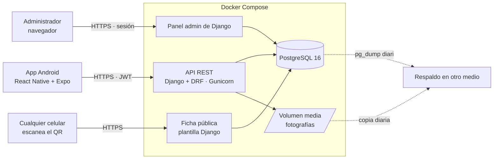
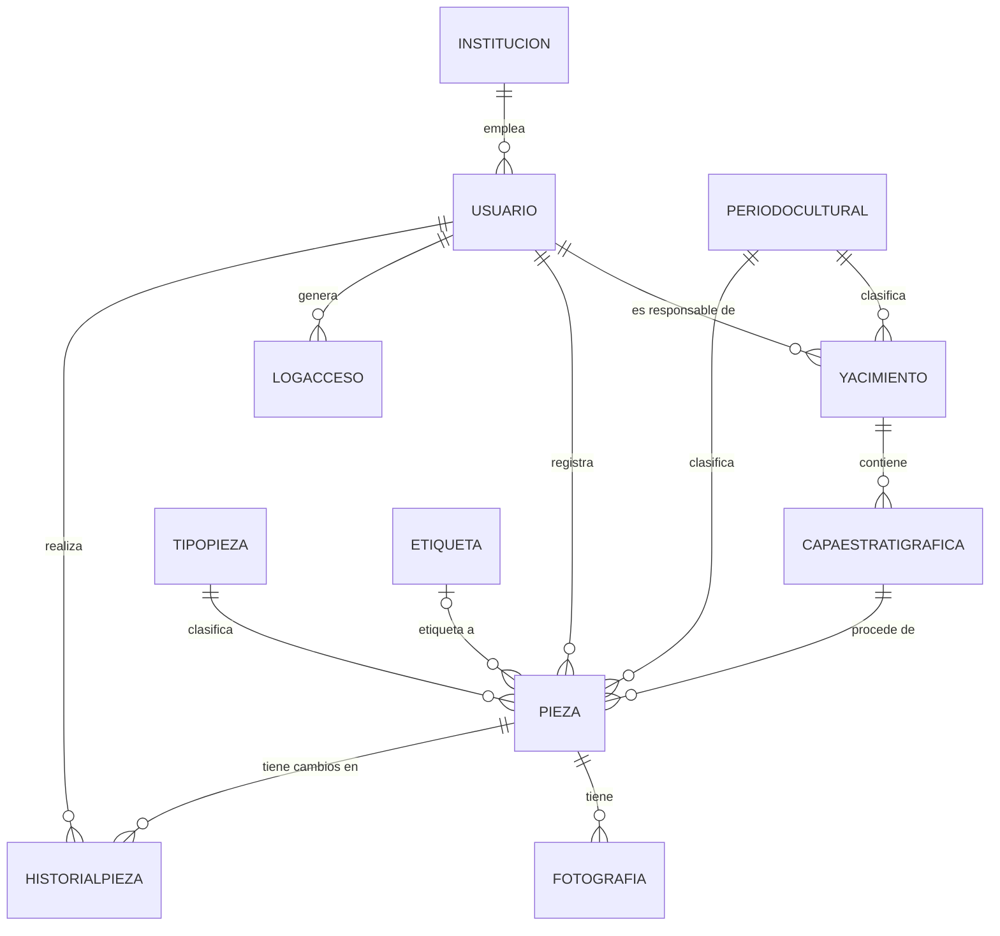
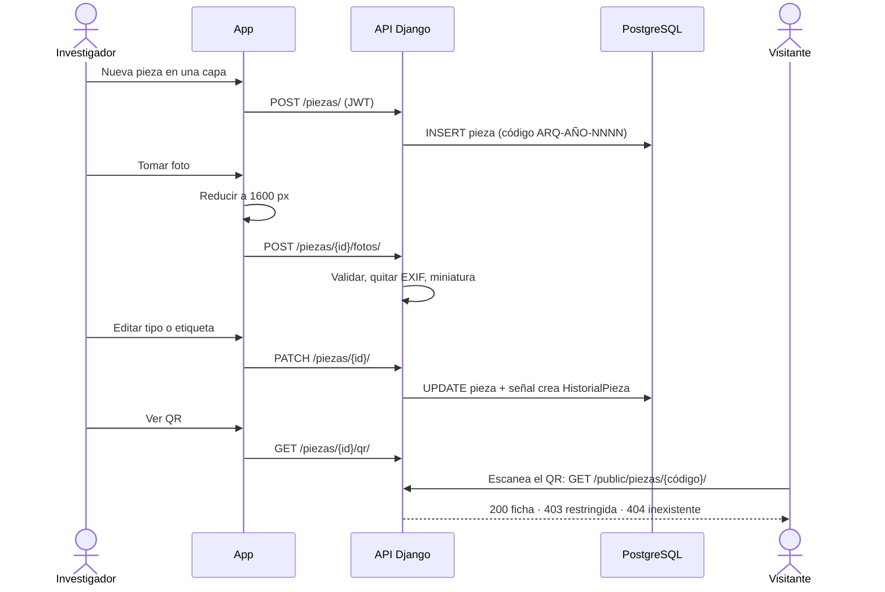

# Informe técnico — ArqueoCatalog

Sistema de información web-móvil para catalogar, dar trazabilidad y gestionar hallazgos arqueológicos.
Proyecto individual de 4 semanas · UMSA, Ingeniería de Sistemas.

> Estado a la fecha de redacción: backend, panel admin, ficha pública y app completos y probados en Docker Compose.
> Pendientes de ejecutar fuera de este repositorio: despliegue final en Dokploy con Cloudflare Tunnel, compilación
> del `.apk` y prueba manual en un celular físico (ver sección 9).

## 1. Resumen

ArqueoCatalog reúne en un solo backend y una sola base de datos cuatro partes:

1. **API REST** (Django 5 + Django REST Framework, PostgreSQL 16, 11 tablas) en `/api/v1/`.
2. **App Android** (React Native + Expo) para investigadores en campo.
3. **Panel de administración de Django** (`/admin/`) para usuarios, instituciones, catálogos, yacimientos y log de accesos.
4. **Ficha pública web**, a la que se llega escaneando el QR de una pieza.

El flujo central es: **capa → pieza → foto → historial → QR → ficha pública**.

## 2. Arquitectura



Decisiones:

- **Un solo backend para tres entradas** (app, admin, ficha pública): una base de datos y un despliegue.
- **El panel admin viene con Django**; solo se personalizó (`admin.py`, tema propio). Concentra lo administrativo y
  permite que la app dedique su interfaz al trabajo de campo.
- **Docker Compose es la base garantizada**; Dokploy reutiliza la misma configuración (`docker-compose.dokploy.yml`).
- **Sin PostGIS, S3 ni mapa embebido** por alcance: las coordenadas son `float` y las fotos van a un volumen en disco.

### Estructura del repositorio

```
backend/   apps: usuarios, catalogos, yacimientos, piezas, nucleo · config · tests
app/       Expo: api/, auth/, catalogos/, componentes/, hooks/, screens/
scripts/   respaldo.sh, restaurar.sh
docs/      informe, manual de usuario, guion de demo, apk, respaldo, Dokploy
```

## 3. Modelo de datos

Once tablas. La procedencia de una pieza es `Pieza → Capa → Yacimiento`; el yacimiento no se duplica en `Pieza`.



Reglas del modelo:

- **Código de pieza** `ARQ-{AÑO}-{SECUENCIA}` (por ejemplo `ARQ-2026-0042`): único y autogenerado al guardar. Si dos
  altas simultáneas calculan el mismo código, la restricción de unicidad lo detecta y se reintenta (hasta 5 veces).
- **`Pieza.etiqueta`** es una FK opcional (una sola etiqueta, no M2M).
- **Coordenadas** del yacimiento: `float` escritos a mano, validados (−90…90 y −180…180). Nunca se leen del EXIF.
- **Capas:** `(yacimiento, codigo)` es único y la profundidad final no puede ser menor que la inicial (restricción en
  base de datos y validación en el serializador).
- **Índices** en las FKs consultadas: capa, periodo, tipo y etiqueta.
- **Catálogos e instituciones** se crean y editan solo en el panel admin; la API los expone de solo lectura.

## 4. Reglas de negocio y cómo se implementan

| Regla | Implementación |
|---|---|
| Eliminación lógica | `activo` en yacimiento, capa y pieza. `EliminacionLogicaMixin` convierte `DELETE` en `activo=False`; las consultas filtran `activo=True`. Solo el Administrador puede hacer `DELETE`. |
| Historial solo de `Pieza` | Señales `pre_save`/`post_save` (`apps/piezas/signals.py`): `pre_save` guarda el estado previo y `post_save` compara y crea un registro por campo modificado. Ninguna vista escribe en `HistorialPieza`. Cubre tipo, periodo, etiqueta, capa y `activo`; además nombre, descripción, material y `publica`. El usuario responsable llega por un contexto de hilo que llena un middleware y las vistas. |
| `LogAcceso` | Señal `user_logged_in`; solo inicios de sesión exitosos (los fallidos no se registran). Visible únicamente en el admin, sin alta ni edición. |
| Ficha pública | `/api/v1/public/piezas/{codigo}/`: **200** si `publica=True` y activa; **403** con la pantalla "Ficha restringida por la institución" y sin ningún dato de la pieza; **404** si el código no existe. Una pieza inactiva se trata como no visible (403). |
| Fotos | Validación de tipo real (se abre con Pillow, no se confía en la extensión) y tamaño (≤ 8 MB); JPEG, PNG o WEBP. La imagen se **reconstruye solo con sus píxeles**, de modo que ningún metadato (EXIF, GPS) sobrevive; antes se aplica la orientación del EXIF. Se limita a 2000 px y se genera miniatura de 400 px. Solo piezas tienen fotos. |
| Control de visibilidad de media | `/api/v1/media/{id}/`: con token, siempre que la pieza esté activa; anónimo, solo si la pieza es pública y activa; en otro caso 404 (no revela que exista). |
| Permisos en el backend | Clase DRF `EsPersonalAutorizado`: Administrador e Investigador pueden crear, editar y consultar; `DELETE` solo el Administrador. `SoloLectura` para catálogos. La interfaz oculta botones, pero la restricción real está en el servidor. |
| Paginación y throttling | Listados paginados (20 por página). Throttling en login (10/min) y ficha pública (60/min). |

## 5. API REST

Base `/api/v1/`, `Authorization: Bearer <JWT>` salvo login, ficha pública, media pública, descarga del apk y salud.

| Método | Endpoint | Descripción |
|---|---|---|
| POST | `/auth/login/`, `/auth/refresh/` | Sesión JWT (acceso 30 min, refresh 7 días) |
| GET | `/auth/me/` | Perfil del usuario |
| CRUD | `/yacimientos/`, `/yacimientos/{id}/capas/`, `/piezas/` | Búsqueda `?search=`; filtros `periodo_cultural`, `estado`, `tipo_pieza`, `etiqueta`, `capa`, `yacimiento`, `publica` |
| POST | `/piezas/{id}/fotos/` | Subida multipart |
| GET | `/piezas/{id}/qr/` | PNG con la URL de la ficha pública |
| GET | `/piezas/{id}/historial/` | Solo lectura |
| GET | `/catalogos/{periodos,tipos,etiquetas}/` | Solo lectura, sin paginar |
| GET | `/media/{foto_id}/` | Foto o `?miniatura=1`, con control de visibilidad |
| GET | `/public/piezas/{codigo}/` | Ficha pública (HTML) |
| GET | `/app/descargar.apk` | Instalador de la app |
| GET | `/health/` | Estado del servicio y de la base de datos |

### Flujo de punta a punta



## 6. App móvil

- **Stack:** Expo, React Navigation (pestañas Yacimientos, Piezas, Perfil, más una pila para detalles y formularios),
  Axios, `expo-image-picker`, `expo-image-manipulator`, `expo-secure-store`.
- **Sesión:** JWT en `expo-secure-store`, nunca en AsyncStorage. Un interceptor renueva el token con el refresh ante
  un 401 y, si también falla, devuelve al login. Se evita más de un refresh simultáneo.
- **Núcleo de campo:** capas y piezas tienen listado, detalle y formulario. El yacimiento usa un formulario mínimo
  (nombre, latitud, longitud, periodo, estado). Las piezas se registran desde una capa.
- **Fotos:** cámara o galería; se reducen a 1600 px (JPEG, calidad 0,8) antes de subir y el servidor además quita los
  metadatos.
- **QR:** lo genera el backend; la app solo lo muestra. **Mapa:** `Linking` abre la app de mapas, sin mapa embebido.
- **Catálogos:** se descargan una vez tras iniciar sesión y alimentan los selectores (solo lectura).
- **Búsqueda y filtros:** búsqueda por texto con retardo de 400 ms; filtros de piezas por periodo, tipo y etiqueta.
- **Permisos en la UI:** "Desactivar" solo se muestra al Administrador (el servidor lo exige igualmente).

## 7. Seguridad

- Secretos solo en variables de entorno (`django-environ`); `.env` no se versiona y se mantiene `.env.example`.
- Producción: `DEBUG=False`, `ALLOWED_HOSTS`, CORS y `CSRF_TRUSTED_ORIGINS` restringidos, cookies seguras y
  `X-Forwarded-Proto` para HTTPS detrás de Traefik/Cloudflare. El contenedor corre con un usuario sin privilegios y el
  único puerto expuesto en el compose de Dokploy es el 8000 interno, a través de Traefik.
- Autorización siempre en el backend. La ficha pública no revela datos de piezas restringidas y las fotos privadas
  responden 404 a anónimos.
- Privacidad de imágenes: eliminación de EXIF/GPS en el servidor.

## 8. Pruebas y calidad

**Backend (`pytest-django`, `factory_boy`): 75 pruebas, todas en verde; Ruff sin errores.** Cubren: generación de
código, permisos por rol (incluida la restricción de `DELETE`), señal de historial, señal de log de acceso, validación
y limpieza de fotos, QR, control de visibilidad de media, ficha pública (200/403/404, pieza inactiva), eliminación
lógica, filtros y búsqueda, paginación, catálogos de solo lectura y descarga del `.apk`.

**App:** ESLint sin errores y el bundle de Android se compila (`expo export`). La verificación funcional de la app se
hace de forma manual en un celular, con el guion de `docs/guion-demo.md`.

## 9. Despliegue, respaldo y distribución

| Elemento | Estado |
|---|---|
| Docker Compose local | Funcionando (PostgreSQL 16 + backend, migraciones y `collectstatic` en el arranque). |
| Compose y guía para Dokploy | Preparados y validados sintácticamente (`docker-compose.dokploy.yml`, `docs/despliegue-dokploy.md`). **Falta ejecutarlos en el servidor** con Cloudflare Tunnel. |
| Respaldo | `scripts/respaldo.sh` (`pg_dump` + volumen de fotos, 14 días de retención) y `scripts/restaurar.sh`. **Restauración probada** sobre la base local: un cambio hecho después del respaldo se revirtió. Falta programar el cron en el servidor y apuntarlo a un disco distinto. |
| `.apk` | Perfil `preview` de EAS configurado y endpoint de descarga implementado (`docs/apk.md`). **Falta compilarlo e instalarlo** en un celular distinto al de desarrollo, con varios días de margen. |

## 10. Metodología

Desarrollo iterativo e incremental en cuatro sprints de una semana con tablero Kanban (GitHub Projects). Cada sprint
cerró con un incremento demostrable:

| Sprint | Incremento |
|---|---|
| 1 | Modelo de 11 tablas migrado, admin con catálogos y datos de ejemplo, Docker Compose y proyecto Expo. |
| 2 | API del núcleo con JWT y roles, historial y log por señales, login en la app. |
| 3 | App de capas y piezas, fotos sin EXIF, QR, ficha pública e historial. |
| 4 | Búsqueda y filtros, respaldo y restauración, descarga del `.apk`, documentación. |

Criterio de terminado: implementado, probado (automático en backend, manual en celular), ejecutándose en Docker
Compose y sin errores de Ruff/ESLint.

## 11. Alcance excluido y trabajo futuro

Quedaron fuera por decisión de alcance: fotos de yacimientos, historial de yacimientos y capas, registro de accesos
fallidos, modo sin conexión, mapa embebido y PostGIS, exportación a PDF/CSV, préstamos entre instituciones, API
pública documentada y distribución en tiendas. Son candidatos para versiones futuras.

## 12. Limitaciones conocidas

- Una sola etiqueta por pieza.
- El historial cubre únicamente piezas.
- Las fotos están en disco local; el respaldo depende de copiar el volumen.
- La app requiere conexión: no hay modo sin conexión.
- El despliegue en Dokploy y el `.apk` no se han ejecutado todavía (sección 9).
